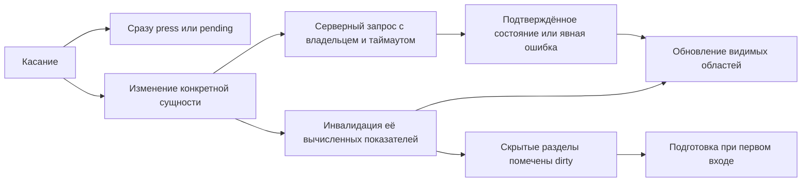

# Disbit: аудит скорости и ТЗ на плавный мобильный интерфейс

**Дата:** 28 октября 2026. **Код:** `e9d98b5`. **Android:** 1.0.6, versionCode 7.

**Результат:** главные возможности ускорения находятся в объёме синхронной работы при обновлении интерфейса, повторных вычислениях истории, загрузке данных и обработке жестов. Текущие 180 мс анимации шторки сами по себе не объясняют задержки в сотни миллисекунд. Сначала освобождаем главный поток и показываем немедленный отклик; затем доводим движения.

Это аудит и техническое задание. Изменены только документы, диагностические сценарии и результаты в `plans/`. Исходники приложения, установленные APK и сервер в рамках этого аудита не обновлялись.

## 1. Что исследовано и как читать выводы

- Прочитаны текущие пути загрузки, синхронизации, общего рендера, вкладок, профиля, друзей, истории, форм, wheel/switch/hold-кнопок, марафонов, магазина персонажа и камеры.
- Разобран действующий каскад CSS: `style.css` → `path-ui.css` → `path-journey.css` → `path-insights.css` → `path-support.css` → `path-motion.css`. Старые правила не объявлялись проблемой, если их перекрывает более поздний слой.
- Сняты три серии навигации и три запуска на физическом **Galaxy A22 SM-A225F**, Android 13 / API 33, WebView `155.0.8059.46`, 720×1600, density 300.
- На телефоне проверено открытие формы обещания без ввода и сохранения: клавиатура появляется автоматически; это совпадает с найденным autofocus в коде.
- В изолированном Chromium `156.0.8078.48` на ПК, viewport 384×774, измерены синтетические наборы 5/30/100 обещаний и 90/365/1095 дней истории. Это не данные владельца аккаунта.
- Отдельно проверены форматтер дат, последовательность API и HTTP-заголовки опубликованных ресурсов.
- Граф проекта использован для поиска связей, но часть его фрагментов устарела. Все выводы привязаны к текущим файлам `e9d98b5`.

**Степени доказанности:** «замер» — получены числа; «код» — путь подтверждён исходниками, вклад в задержку требует измерения; «гипотеза» — нужен эксперимент A/B. Полный INP реальных пользователей, GPU-trace, потребление батареи и удержание памяти здесь не измерялись.

## 2. Полученная исходная точка

### 2.1. Общая отрисовка на синтетических данных

Три измерения после прогрева. Значения — медиана синхронного `render()`, без ожидания сети и следующей отрисовки браузера. Вызовы временно обёрнуты счётчиками в памяти изолированной страницы; такая диагностика добавляет некоторую стоимость. Функциональные времена вложенные, их нельзя складывать между собой.

Синтетические обещания — простая отметка, расписание 7 дней, история заполнена примерно на 70%; друзья и журнал штрафов в этом тесте пусты. Чтобы все сцены оставались незавершёнными, в диагностике выставлен искусственный размер маршрута 100 000 шагов. Это технический способ измерить стоимость истории и списка, а не допустимый пользовательский сценарий или предложение изменить лимиты продукта. Финальную приёмку дополнить данными, допустимыми через обычные формы.

| Набор | Маршруты | `render()` без замедления CPU | Среднее время `renderStats` за вызов | DOM-элементы всей страницы после построения |
|---|---:|---:|---:|---:|
| 5 обещаний, 90 дней | 1 | **42,7 мс** | 33,7 мс | 3512 |
| 30 обещаний, 365 дней | 6 | **133,9 мс** | 75,5 мс | 5012 |
| 100 обещаний, 1095 дней | 20 | **967,8 мс** | 516,8 мс | 9165 |

Последняя строка — стресс-проверка, а не типичный аккаунт. Число DOM включает скрытые разделы и SVG-спрайт; это не число новых узлов на каждый кадр. При CPU throttle ×4 медианы были 724 / 1206 / 8314 мс. Этот режим диагностический, **не модель Galaxy A22**; не использовать эти цифры для обещаний пользователям. При повторной приёмке исключить параллельные тяжёлые замеры.

В одном `render()` найдено 259 вызовов `formatDay`. В большом наборе `computeBestStreak` получил 300 вызовов на render: история одного обещания заново обходится из нескольких представлений.

### 2.2. Изолированный тест форматирования

259 одинаковых дат, три прохода:

| Способ | Времена | Медиана |
|---|---|---:|
| Текущий `Date.toLocaleDateString` с options в каждом вызове | 36,0 / 38,3 / 44,9 мс | 38,3 мс |
| Один `Intl.DateTimeFormat`, повторно используемый для всех дат | 0,9 / 0,9 / 0,8 мс | 0,9 мс |

Все строки совпали. Выигрыш относится к этой операции. Для общего ускорения ещё нужно убрать невидимые пересчёты и повторные обходы истории.

### 2.3. Galaxy A22: переходы

Для каждого прохода статистика `gfxinfo` сброшена; далее выполнено 12 касаний Profile → Friends → Marathon → Today, три цикла, пауза 0,5 с между касаниями. Пять существующих обещаний; активных марафонов на устройстве в этой проверке не было.

| Проход | Учтено кадров окна | p50 | p90 | p95 | p99 | Системный `Janky frames` |
|---|---:|---:|---:|---:|---:|---:|
| 1 | 98 | 21 мс | 61 мс | 81 мс | 109 мс | 95 / 98 |
| 2 | 116 | 17 мс | 38 мс | 48 мс | 57 мс | 98 / 116 |
| 3 | 88 | 22 мс | 53 мс | 73 мс | 105 мс | 84 / 88 |

Это системная статистика кадров окна WebView, не точный FPS интерфейса и не INP. Три коротких прохода недостаточны для полевой статистики; они подтверждают необходимость подробной трассы. Они также не доказывают, что причиной является blur: для этого нужен отдельный эксперимент.

### 2.4. Запуск и синхронизация

- `am start -W` после остановки процесса: `TotalTime` 1066 / 1013 / 967 мс. Медиана **1013 мс** — запуск Activity, не готовность веб-интерфейса и не окончание загрузки аккаунта. Кэш ОС не очищался.
- В localhost добавлена контролируемая задержка 150 мс на API-запрос. Основная цепочка содержала 7 последовательных GET: `auth/me` → `habits` → `charges` → `state` → `friends` → `wallet` → `habits/skips/quota`. Весь проход до окончания bootstrap — 1438 мс. В сырых данных есть ещё один ранний GET `/state` от предыдущего прохода; он исключён из подсчёта семи запросов.
- Первый локальный интерфейс уже показывается до завершения bootstrap. Проблема — задержка применения свежих данных и слишком широкое завершающее обновление.

### 2.5. Веб-ресурсы

- Верхнеуровневые JS: 394 333 байта; CSS: 180 424; `index.html`: 89 331. Основной `script.js`: 278 196 байт; локальное gzip-представление около 79 805 байт.
- На рабочем сайте `script.js` уже отдаётся с **gzip**. Отсутствие сжатия не является найденной проблемой.
- JS и проверенный WOFF2-шрифт имеют `Cache-Control: public, max-age=0`, ETag/Last-Modified. Повторный запуск веба требует перепроверки ресурсов.
- В APK эти ресурсы лежат локально. Изменение HTTP-кэша не ускорит само переключение вкладок установленного APK.

Сырые данные: [браузер](runtime-performance-results.json), [даты](date-format-results.json), [A22: вкладки](galaxy-a22-navigation-baseline.json), [A22: запуск](galaxy-a22-launch-baseline.json).

## 3. Подтверждённые находки по приоритету

HIGH — влияет на частые действия или может создавать длительную блокировку. MEDIUM — локальная задержка, жизненный цикл или доступность. У гипотезы не указывается обещанный выигрыш до A/B.

| ID | Приоритет / основание | Место в текущем коде | Найдено | Исправление |
|---|---|---|---|---|
| F01 | HIGH, замер | `script.js:4816–4819`, `2331`; `path-insights.js:58–63` | 259 форматирований дат на общий render; повторное создание форматтера дорого | Переиспользуемые Intl-форматтеры; план 001 |
| F02 | HIGH, замер + код | `script.js:875–886` | Изменение обещания обновляет скрытые календарь, статистику, профиль и списки | Render по областям и dirty/revision; план 002 |
| F03 | HIGH при росте истории, замер | `script.js:556–600`, `2257–2273`, `2444–2450` | Повторные обходы истории ради серий/достижений; до 300 `computeBestStreak` на render в стресс-наборе | Один вычисленный результат на сущность и ревизию; план 002 |
| F04 | HIGH для синхронизации, код + искусственная задержка | `script.js:379–432` | Семь последовательных зависимых по ожиданию GET, хотя часть данных независима | После проверки владельца параллельные чтения, раннее применение обещаний; план 003 |
| F05 | HIGH на плохой сети, код | `script.js:338–348`; `path-support.js:44–50` | Базовый `apiCall` не имеет таймаута; bootstrap остаётся busy до завершения | Общий координатор запросов и отмена устаревших чтений; план 003 |
| F06 | MEDIUM, код | `script.js:3753–3785`, `2805–2852` | На одно посещение друзей до 4 вызовов списка и 3 панели; повторные GET | Один владелец обновления, объединение in-flight, политика свежести |
| F07 | HIGH для жеста, код | `path-motion.js:209–251` | На каждом pointermove заново создаются строки всех колонок wheel | Постоянные строки, обновление только активной колонки, один rAF; план 004 |
| F08 | MEDIUM, код | `path-motion.js:223–254` | Новая доводка wheel начинается с фиксированного ±40px; отпускание обнуляет offset | Продолжать из текущей позиции, доводка к строке |
| F09 | HIGH для открытия формы, код + A22 | `script.js:3796–3798`; `path-support.css:35–39` | Шторка и клавиатура запускаются одновременно из microtask autofocus | На touch фокус контейнера, клавиатура по нажатию поля; план 005 |
| F10 | MEDIUM, код | `path-ui.js:14–23,43–68,188–192` | Каждый символ обновляет preview и сериализует весь черновик формы | Локальные изменения, объединение по кадру, отложенная запись с flush |
| F11 | MEDIUM, код | `style.css:1595–1613`; `script.js:4405,4435` | Thumb switch меняет width/height и унаследованную CSS-переменную на родителе | Фиксированный box, transform на самом thumb; план 004 |
| F12 | MEDIUM, доступность, код | `path-motion.js:137–142`; `path-support.js:20–26` | Hold запускает WAAPI заново даже при включённом reduce; CSS это не отключает | Статическая обратная связь reduce, таймер 1000 мс сохранить |
| F13 | MEDIUM, код | `script.js:1461–1494` | На Marathon удаляются карточки остальных маршрутов, Today создаёт их снова | Сохранение DOM по goal.id и обновление по ревизии; план 006 |
| F14 | MEDIUM, код | `script.js:3404–3442,3837–3869`; `path-journey.js:36–38` | Студия при каждом входе создаёт все SVG экипировки и сцен | Статические варианты один раз, ленивые блоки; план 006 |
| F15 | HIGH для камеры, код, CPU не измерен | `script.js:4001–4030,4102–4116` | Захват без ограничения качества; зеркальный canvas рисует каждый display frame | Ограничения качества, обработка видео-кадров максимум 30 FPS |
| F16 | HIGH для жизненного цикла, код | `script.js:4146–4158,4217–4226` | На preview камера скрыта, но поток жив; производный stream не хранится для полной очистки | Единый dispose потоков/recorder/rAF/src/URL; план 006 |
| F17 | MEDIUM для веб-запуска, HTTP-замер | `backend/server.js:76`, `frontend/index.html:конец` | Независимо от изменений ресурсы revalidate, весь функционал загружается сразу | Хэшированные assets и осторожное отложенное подключение; план 007 |
| F18 | MEDIUM, измерить перед миграцией | `script.js:273–278,324–335,203–232` | Сериализуются весь массив обещаний и общий state | Сначала убрать повторы и замерить storage; асинхронное хранилище только при необходимости |
| F19 | Гипотеза GPU, A/B | `style.css:2243–2247`; `path-ui.css:137,155` | Полноэкранный blur 3px у шторки и 10px у dock на touch | Сравнить с плотной стеклянной подложкой, сохранить Glass Light |
| F20 | LOW, после основного | `script.js:307–322`; `style.css:2391–2399` | Счётчик недельной цели пересоздаёт цифры, 450 мс при каждом изменении | При подтверждённом раздражении — 180 мс / мгновенный быстрый ввод |

Для F15/F16 подтверждён жизненный цикл объектов, но не измеренная утечка памяти. Для F19 пока нет доказанной доли GPU-затрат.

## 4. Что сохранить

1. Вкладки сейчас переключаются **без общей анимации**: `path-support.css:34` перекрывает старый `fadeUp`. Сокращать несуществующую анимацию нельзя.
2. Повторный тап активной вкладки уже возвращается без работы (`script.js:3757`).
3. `syncPathNavigation` уже пропускает Profile/Friends/History (`path-ui.js:141–163`); дополнительный `renderWalker` из общего render ранее удалён.
4. `renderWalkerCard` сохраняет SVG, пока не поменялась подпись карточки. Оптимизировать потерю этого кэша между экранами, а не удалять его как якобы отсутствующий.
5. Фоновые ауры скрыты; массовые входы карточек и постоянные декорации среды отключены. Путник вне viewport приостанавливает CSS-анимацию.
6. Эффективные токены уже хорошие: `--motion-ui:180ms`, `--motion-press:140ms`, `--ease-out:cubic-bezier(.23,1,.32,1)`.
7. История депозита уже загружается страницами по 30, в профиле две записи; изоляция аккаунтов обязательна.
8. Подтверждение удержанием 1000 мс и шаг путешественника 700 мс имеют назначение. Их не уменьшать только ради ощущения скорости.

## 5. Целевая схема работы интерфейса

**Требования к данным и рендеру:**

- Единые ревизии habits/history/goals/profile/friends/wallet; скрытая статистика не вычисляется из-за изменения мотивации или захода в друзей.
- Показатели обещания: текущая/лучшая серия, выполнено за период, недельный результат. Показатели маршрута: done/total/percent/streak. Вычислять один раз на ревизию и передавать представлениям.
- Инвалидация включает серверное обновление, отмену/пропуск/минимум, изменение расписания и связей, архив/восстановление, смену владельца, часового пояса и календарного дня.
- Один запланированный DOM-flush за кадр для неотложных видимых изменений. Тяжёлые невидимые вычисления не класть просто в `queueMicrotask`: microtask тоже блокирует следующий paint.
- Кэш ограничен и привязан к владельцу. При logout/смене аккаунта сбрасываются вычисленные модели, in-flight чтения и личные DOM-данные.
- Нужная тяжёлая страница сначала показывает заголовок/существующие данные и состояние загрузки; вычисление разбивается на задачи только там, где это действительно требуется после кэширования.

**Требования к сети:**

- После `/auth/me` независимые чтения запускать параллельно с проверкой auth-generation до применения ответа. Promise.allSettled не должен удерживать показ обещаний до ответа друзей.
- GET одного ресурса для одного владельца объединяется, устаревший запрос отменяется. Политика свежести допускается для друзей/настроек; подтверждение денег и пруфа требует серверной истины.
- Таймаут и ошибка должны быть явными; при uncertain POST нельзя автоматически повторять платёж с новым ключом. Сохранить идемпотентность.
- Локальный экран/кэш показывается сразу с понятной отметкой синхронизации. Новый баланс или подтверждённое выполнение не рисовать раньше серверного подтверждения.

## 6. Правила анимации и переходов

Общий принцип: действие принимается сразу; анимация не закрывает ввод и не служит таймером бизнес-операции. Двигать transform/opacity, не геометрию layout. Правила reduced motion проверяются отдельно для CSS и WAAPI.

| Элемент | Целевое поведение |
|---|---|
| Нижние вкладки | Сразу активировать целевой раздел и пункт меню; массового slide/fade всего экрана нет |
| Необязательная мягкость содержимого | Только после выполнения бюджетов: opacity 125 мс `cubic-bezier(.23,1,.32,1)` для уже готового нового блока, без задержки клика и без скрытия всего экрана |
| Обычная кнопка | Press 140 мс ease-out, scale 0,97; визуальный отклик начинается на pointerdown/CSS active, само действие сохраняет click/keyboard семантику |
| Шторка / диалог | 180 мс `cubic-bezier(.23,1,.32,1)`, transform+opacity; повторное закрытие перенацеливает текущую позицию |
| Wheel | Строки постоянные, во время drag transition нет; доводка 180 мс из фактической позиции, новая попытка прерывает её без скачка |
| Switch | Drag следует за пальцем, фиксированный layout box; доводка transform 140–160 мс; ни width/height, ни повторный запуск от начальной точки |
| Hold | 1000 мс бизнес-таймер; reduce — статическое состояние удержания, без scaleX-анимации; ответ после подтверждения быстрый |
| Прогресс | Менять transform scaleX, не width; финансовый смысл не подтверждать анимацией |
| Персонаж после выполнения | Сохранить выразительный шаг примерно 700 мс; остальные кнопки и закрытие доступны, ожидание анимации не удерживает синхронизацию |
| Toast | Существующий короткий transition до 200 мс; несколько событий не перезапускают все сообщения с нуля |
| Смена темы | Редкое действие, текущие 280 мс допустимы после GPU-проверки; reduce/слабое устройство — простое переключение или opacity 180 мс |

Glass Light сохраняет светлую полупрозрачную подложку, тонкую границу, активный пункт и размер touch targets. Если A/B покажет выигрыш без blur, эффект делается плотной подложкой с границей/тенью, а не заменой нижнего меню другим стилем. Не добавлять `will-change` ко всем узлам постоянно.

## 7. Маршрут реализации

| Этап | Действия | Результат и зависимость |
|---|---|---|
| 0 | Зафиксировать базу, метрики, одинаковые сценарии A22 и synthetic | План 008 запускается до изменений |
| 1 | Переиспользовать форматтеры, исключить горячее создание Intl | План 001, небольшой независимый шаг |
| 2 | Разделить global render на видимые области/dirty; ленивые calendar/stats | Первая часть 002, главный эффект в повседневном сценарии |
| 3 | Общие вычисляемые модели истории/серий/маршрутов | Вторая часть 002; сначала корректность инвалидации |
| 4 | Параллельный bootstrap, таймауты, dedupe, один render друзей | План 003, сохранить изоляцию и финальность серверных действий |
| 5 | Постоянные строки wheel, rAF, корректное прерывание; switch transform | План 004, отдельный замер жеста |
| 6 | Мобильный фокус, keyboard/layout, черновик формы, reduced motion hold | План 005 |
| 7 | Устойчивые карточки маршрутов, ленивый магазин персонажа | План 006, зависит от модели 002 |
| 8 | Жизненный цикл камеры, качество/частота, отправка/повтор | План 006, отдельный тест пруфов на QA-аккаунте |
| 9 | Веб-кэш assets, безопасное версионирование, подготовка редких модулей | План 007; не смешивать с большим рендер-рефакторингом |
| 10 | Повторный замер сериализации; storage-миграция при доказанном остаточном bottleneck | План 003, условный этап |
| 11 | A/B blur и финальная полировка переходов в пределах бюджета | План 005 после основных задержек |
| 12 | Контрактная, браузерная и физическая приёмка, подписанный APK, staging/rollout | План 008 |

В каждой итерации выпускать один проверяемый блок. Массовая смена фреймворка, новой библиотеки анимации и слоя данных одновременно усложнит проверку, а измеренные горячие функции останутся предметом оптимизации в любом стеке.

## 8. Когда считать приложение заметно быстрее

Это **проектные цели приёмки**, а не результаты текущего аудита:

- p95 первого визуального отклика обычной кнопки ≤50 мс на A22.
- Тёплая вкладка с загруженными данными: касание → первый кадр содержимого p95 ≤150 мс; синхронная работа обработчика ≤20 мс на наборе 30/365.
- При изменении одной отметки скрытые stats/calendar не меняют DOM и не пересчитывают серии; неизменённые SVG не создаются повторно.
- Жест wheel обрабатывается максимум один раз за animation frame; строки не выделяются заново на pointermove; нет скачка при реверсе.
- Для режима 60 Гц целевой бюджет кадра 16,7 мс. Промежуточный gate p95≤33 мс и снижение системных misses ≥50% в одинаковом сценарии; полноценная трасса должна подтвердить причину и результат.
- Для веба полевые Core Web Vitals: INP≤200 мс, LCP≤2,5 с, CLS≤0,1 на p75 по мобильным/настольным сессиям. [Определения и пороги Google](https://web.dev/articles/vitals).
- «Отмена», Back, другой таб и повторное открытие не ждут окончания декоративной анимации. Клавиатура не появляется сама на каждом открытии формы touch-устройства.
- Баланс/статус оплаты, число пропусков, серия и доказательство выполнения остаются правильными после logout/login, offline/retry, перезапуска и смены дня.

INP измеряет время до следующей видимой реакции, а не длительность серверной операции. Поэтому надёжная загрузка с быстрым pending-состоянием может отвечать критерию отзывчивости, даже когда сеть медленная. [Что измеряет INP](https://web.dev/articles/inp).

## 9. Дополнительные небольшие возможности

После освобождения главного потока можно добавить три адресных улучшения: мгновенное pending-состояние отмечаемой карточки; короткое обновление изменившейся строки вместо появления всего списка; сохранённый экран с отдельным индикатором фонового обновления. Это помогает понимать действие без дополнительных обязательных движений.

## 10. Открытые проверки

- Не сняты Perfetto-трасса, настоящий JS-профиль renderer A22 и покадровое видео жестов.
- Не проверены на устройстве камера, качество/кодирование видео, 20 циклов очистки памяти, расход батареи и фоновые ограничения.
- Нет измерений физического iPhone, Android 15/16, реальной плохой мобильной сети и полевого INP.
- Не сделан A/B blur и не доказано, какая доля задержки приходится на GPU.
- Не измерена серверная нагрузка авторизованного API под конкурентными пользователями. Read-only HEAD ресурсов не является нагрузочным тестом.
- Данные пользователя не использовались для оплаты/покупок/удаления/новых отметок. На телефоне выполнялись навигация, открытие и отмена пустой формы и перезапуск приложения.

## 11. Пакет для исполнителя

Планы 001–008 содержат текущие места кода, точные цели, подшаги, границы и QA. Выполнять их по [README](README.md), а результаты обновлять по мере реализации. В этой поставке все планы имеют статус TODO.

Технические источники: [Web Interface Guidelines](https://raw.githubusercontent.com/vercel-labs/web-interface-guidelines/main/command.md), [Android: rendering inspection](https://developer.android.com/topic/performance/rendering/inspect-gpu-rendering). Конкретные числовые бюджеты Disbit в разделе 8 строже стандартного полевого порога INP и являются нашим предложением для продукта.
